# ✉️ Mailora · Identity E-Posta Yönetim Sistemi

**M&Y Yazılım Eğitim Akademi · 12. Dönem Bootcamp · Gündüz Grubu Proje Case Çalışması**

ASP.NET Core MVC, ASP.NET Core Identity ve Entity Framework Core ile geliştirilmiş, kullanıcıya özel çalışan ve tüm verilerini SQL Server'da tutan bir e-posta yönetim sistemi. Arayüz için verilen statik **Mailora** teması parçalanarak (Layout + ViewComponent) dinamik hale getirildi.

---

## 🧰 Kullanılan Teknolojiler

| Katman | Teknoloji |
|---|---|
| Web | ASP.NET Core MVC (.NET 9), Razor, Tag Helpers, ViewComponents |
| Kimlik | ASP.NET Core Identity (UserManager, SignInManager, Token Providers) |
| Veri | Entity Framework Core 9 (Code First, Migrations), SQL Server |
| E-posta | MailKit / MimeKit (Gmail SMTP) |
| Arayüz | Bootstrap 5, Bootstrap Icons, Chart.js, Mailora teması |

---

## ✅ Case Maddeleri ve Karşılıkları

### 01 · Üyelik, giriş ve hesap doğrulama
- **Register / Login / Logout** Identity ile çalışır (`RegisterController`, `LoginController`).
- Kayıtta **6 haneli doğrulama kodu** üretilir, **10 dakika** geçerlidir ve e-postayla gönderilir (`VerificationCodeService`).
- Kod girilmeden giriş yapılamaz (`options.SignIn.RequireConfirmedEmail = true`). Doğrulanmamış kullanıcı, şifresi doğruysa doğrulama ekranına yönlendirilir.
- Doğrulama ekranında 6 kutucuklu kod girişi, **kodu tekrar gönder** (60 sn bekleme) ve hatalı deneme sınırı bulunur.
- Giriş gerektiren tüm sayfalar `[Authorize]` ile korunur. **401 / 403 / 404** sayfaları `ErrorPagesController` ve `UseStatusCodePagesWithReExecute` ile gösterilir.

### 02 · Şifre işlemleri ve güvenlik
- **Şifremi Unuttum:** Identity token'ı ile **30 dakika geçerli, tek kullanımlık** sıfırlama bağlantısı gönderilir (`PasswordController`).
- Süresi dolmuş / kullanılmış / bozuk bağlantılar `VerifyUserTokenAsync` ile baştan yakalanır ve kullanıcıya güvenli bir uyarı gösterilir.
- Hesap var mı yok mu bilgisi dışarı sızdırılmaz (her durumda aynı mesaj).
- Profil ekranından **mevcut şifre değiştirme** (`ChangePasswordAsync` + `RefreshSignInAsync`).
- **IDOR koruması:** Hiçbir sorgu yalnızca `id` ile yapılmaz; her sorgu giriş yapan kullanıcının e-postasıyla filtrelenir (`Helpers/MessageQueries.cs`). URL'deki id değiştirilerek başkasının mesajı açılırsa **403**, olmayan mesajda **404** döner.
- Tüm POST işlemlerinde **AntiForgery** token, girişte **5 hatalı denemede 5 dk kilitleme**, `returnUrl` için açık yönlendirme (open redirect) kontrolü.
- Zengin metin editöründen gelen HTML, kaydedilmeden önce **allowlist sanitizer** ile temizlenir (XSS koruması, `Helpers/HtmlSanitizer.cs`).

### 03 · Gelen Kutusu ve mesaj detayları
- Gelen mesajlar yalnızca oturum açan alıcıya göre listelenir.
- Mesaj detayı, otomatik okundu işaretleme, **okunmadı yap**, **yıldızla / yıldızı kaldır** (AJAX), önceki / sonraki mesaj, klavye kısayolları (j / k / Esc).
- **Arama**, **kategori filtresi**, **okunmamış / yıldızlı filtresi**, **tarihe göre sıralama** (en yeni / en eski) ve **sunucu tarafı sayfalama**.
- Okunmamış sayısı sidebar rozetinde, sayfa başlığında ve navbar bildirimlerinde dinamik.

### 04 · Yeni mesaj ve gönderim
- Gönderen bilgisi **formdan değil Identity hesabından** alınır.
- Alıcı (e-posta formatı), kategori, konu ve içerik hem tarayıcıda hem sunucuda doğrulanır.
- Kayıtlı kullanıcıya gönderilen mesaj alıcının **Gelen Kutusu**na, gönderenin **Gönderilenler**ine düşer.
- Alıcı Mailora'da kayıtlı değilse mesaj **SMTP ile gerçek e-posta adresine** gönderilir. Kayıtlı alıcılar için de "e-posta kopyası gönder" seçeneği vardır.

### 05 · Gönderilenler, yıldızlılar, taslaklar ve çöp kutusu
- Tüm kutular kullanıcıya özel listelenir.
- **Taslak:** kaydet → Taslaklar'dan aç → düzenle → gönder.
- **Çöp kutusu:** taşı → geri al → kalıcı sil → çöpü boşalt.
- **Yanıtla** (alıntılı) ve **İlet** (iletilen mesaj başlığıyla).
- Bir mesaj tek satırdır ama iki kişiye aittir; bu yüzden yıldız ve silme bilgileri **alıcı ve gönderen için ayrı** tutulur. Alıcının çöpe attığı mesaj gönderenin Gönderilenler sayfasından kaybolmaz; iki taraf da kalıcı silince satır veritabanından tamamen kaldırılır.

### 06 · Kategoriler, profil ve hesap ayarları
- Kategoriler veritabanından gelir (renkleriyle); mesaj oluştururken seçilir, sidebar'dan ve liste çiplerinden filtrelenir.
- Profil: ad, soyad, telefon, hakkımda ve **profil fotoğrafı yükleme / kaldırma** (tip ve 2 MB boyut kontrolü).
- Navbar ve profil ekranında oturum açan kullanıcının adı, kullanıcı adı, e-postası ve fotoğrafı gösterilir.

### 07 · Dashboard ve özet istatistikler
- Gelen, gönderilen, okunmamış, yıldızlı, taslak ve çöp adetleri **gerçek verilerden** hesaplanır.
- Son 14 günün **gelen / gönderilen trafik grafiği** ve **kategorilere göre dağılım** (donut) grafiği (Chart.js).
- Son gelen 5 mesaj ve en sık yazışılan kişiler.

### 08 · İsteğe bağlı geliştirmeler (yapılanlar)
- Navbar'da **yeni mesaj bildirimleri** (okunmamış son 5 mesaj).
- Kayıt formunda **kullanıcı adı müsaitlik kontrolü** (AJAX).
- Kullanıcı adı **veya e-posta** ile giriş, **Beni hatırla**.
- Identity hata mesajlarının **Türkçeleştirilmesi** (`CustomIdentityErrorDescriber`).
- Mailora temasına uygun **HTML e-posta şablonları** (doğrulama kodu, şifre sıfırlama, mesaj bildirimi).

---

## 🚀 Kurulum

### 1. Veritabanı bağlantısı
`appsettings.json` → `ConnectionStrings:DefaultConnection` değerini kendi SQL Server adınıza göre düzenleyin:
```json
"DefaultConnection": "Server=SUNUCU_ADINIZ\\SQLEXPRESS;Initial Catalog=IdentityEmailDb;Integrated Security=true;TrustServerCertificate=true"
```

### 2. E-posta (SMTP) ayarları
`appsettings.Secrets.example.json` dosyasını kopyalayıp adını **`appsettings.Secrets.json`** yapın ve Gmail bilgilerinizi girin:
```json
{
  "MailSettings": {
    "SenderEmail": "ornek@gmail.com",
    "Password": "16 haneli uygulama şifresi"
  }
}
```
> Gmail'de **2 Adımlı Doğrulama** açık olmalı; şifre olarak normal Gmail şifresi değil, *Google Hesabı → Güvenlik → Uygulama şifreleri* bölümünden alınan **uygulama şifresi** kullanılır. Bu dosya `.gitignore` sayesinde GitHub'a gönderilmez.

### 3. Migration
Package Manager Console'da (Default project: `MYAcademy_identityEmailProject`):
```
add-migration mig3_CaseFeatures
update-database
```

| Migration | İçerik |
|---|---|
| `mig1` | Identity tabloları, Categories, Messages |
| `mig2` | AppUser → `ValidCode` (6 haneli doğrulama kodu) |
| `mig3_CaseFeatures` | AppUser → `ValidCodeExpireDate`, `CreatedDate` · Category → `Color` · Message → taslak, çöp kutusu ve gönderen tarafı yıldız alanları, e-posta index'leri |

Uygulama ilk açıldığında varsayılan kategoriler (**İş, Kişisel, Fatura, Genel**) otomatik eklenir (`Data/DbSeeder.cs`).

### 4. Çalıştırma
Projeyi çalıştırın (F5). Ana sayfa giriş yapılmamışsa **Giriş**, yapılmışsa **Dashboard** ekranına yönlendirir.

> **Not:** E-posta doğrulaması zorunlu olduğundan, bu özellikten önce oluşturulmuş hesaplar (`EmailConfirmed = 0`) giriş yaparken doğrulama ekranına yönlendirilir. Orada **Kodu tekrar gönder** ile yeni kod alınabilir. Test ortamında isterseniz SQL ile de doğrulayabilirsiniz:
> ```sql
> UPDATE AspNetUsers SET EmailConfirmed = 1 WHERE UserName = 'kullanici_adiniz';
> ```

---

## 🗂️ Proje Yapısı

```
MYAcademy_identityEmailProject
├── Controllers
│   ├── RegisterController      → kayıt + kullanıcı adı kontrolü
│   ├── ConfirmMailController   → 6 haneli kod doğrulama, kodu tekrar gönder
│   ├── LoginController         → giriş, çıkış
│   ├── PasswordController      → şifremi unuttum, şifre sıfırlama
│   ├── MessageController       → kutular, detay, yeni mesaj, taslak, çöp, yanıtla / ilet
│   ├── DashboardController     → istatistikler ve grafikler
│   ├── ProfileController       → profil bilgileri, fotoğraf, şifre değiştirme
│   └── ErrorPagesController    → 401 / 403 / 404
├── Entities                    → AppUser, Message, Category
├── Context                     → EmailContext (IdentityDbContext<AppUser>)
├── Models                      → ViewModel'ler
├── Services                    → MailService, VerificationCodeService, ImageUploadService, e-posta şablonları
├── Helpers                     → MessageQueries (kutu kuralları), HtmlSanitizer, CustomIdentityErrorDescriber, MailoraUi
├── Data                        → DbSeeder (varsayılan kategoriler)
├── ViewComponents              → Mailora layout (Style / Sidebar / Header) ve Register parçaları
└── Views
    ├── MessageLayout/Index     → panel layout'u (@RenderBody)
    ├── Shared/_AuthLayout      → giriş / doğrulama / şifre ekranlarının ortak düzeni
    ├── Message                 → MessageList, MessageDetail, CreateMessage
    ├── Dashboard, Profile, Login, Register, ConfirmMail, Password, ErrorPages
```

---

## 📸 Ekran Görüntüleri

### Üyelik, doğrulama ve şifre işlemleri
| Giriş ekranı | Hatalı giriş uyarısı |
|---|---|
| 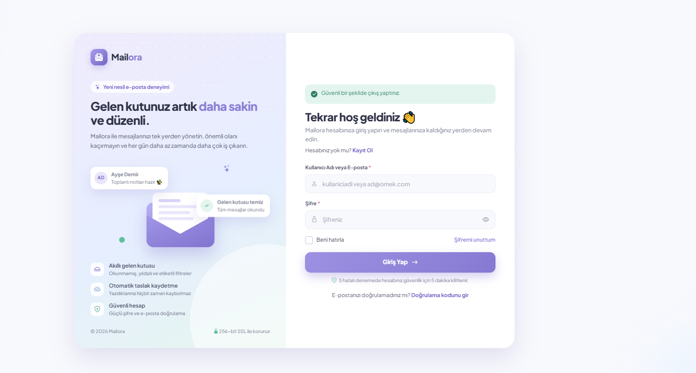 | 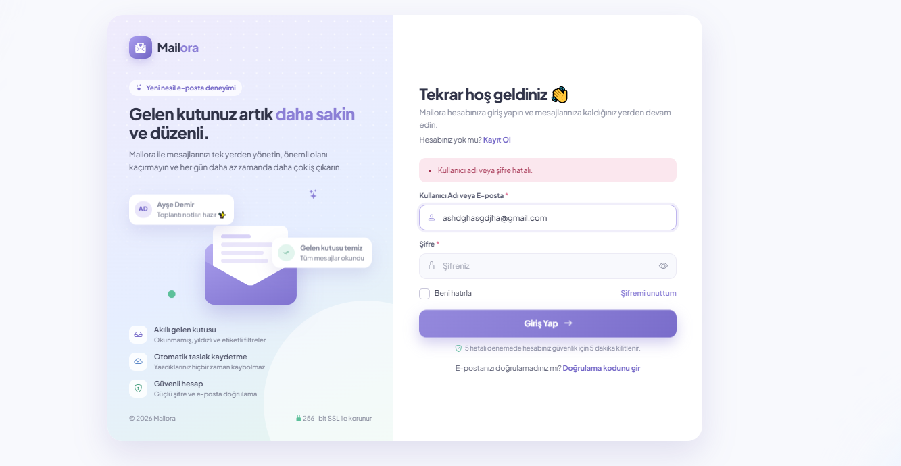 |

| 5 hatalı denemede hesap kilitleme (5 dk) |
|---|
| 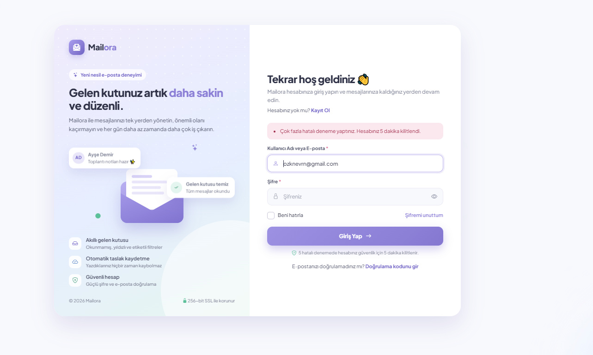 |

| E-posta doğrulama (6 haneli kod) | Doğrulama kodu e-postası |
|---|---|
| 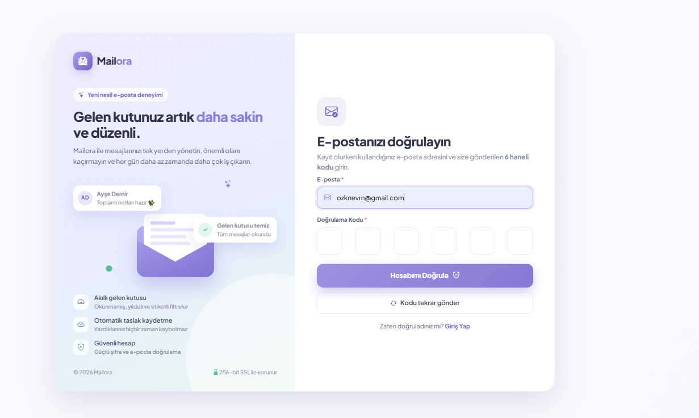 | 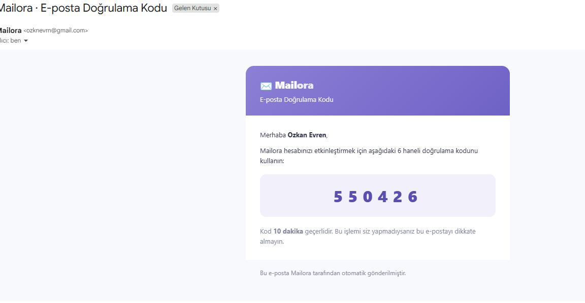 |

| Şifremi unuttum | Tek kullanımlık şifre sıfırlama e-postası |
|---|---|
| 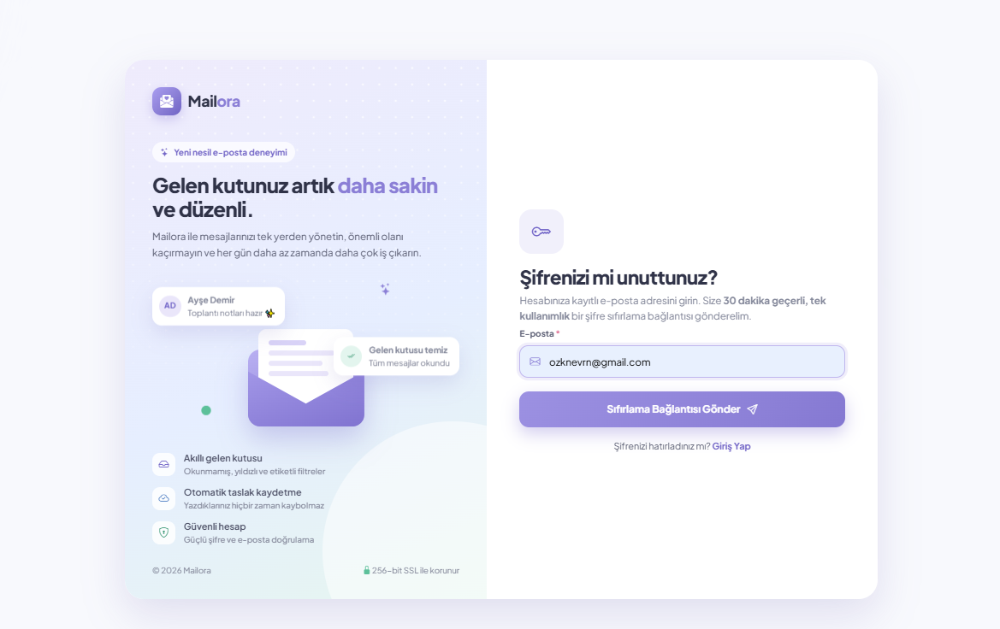 | 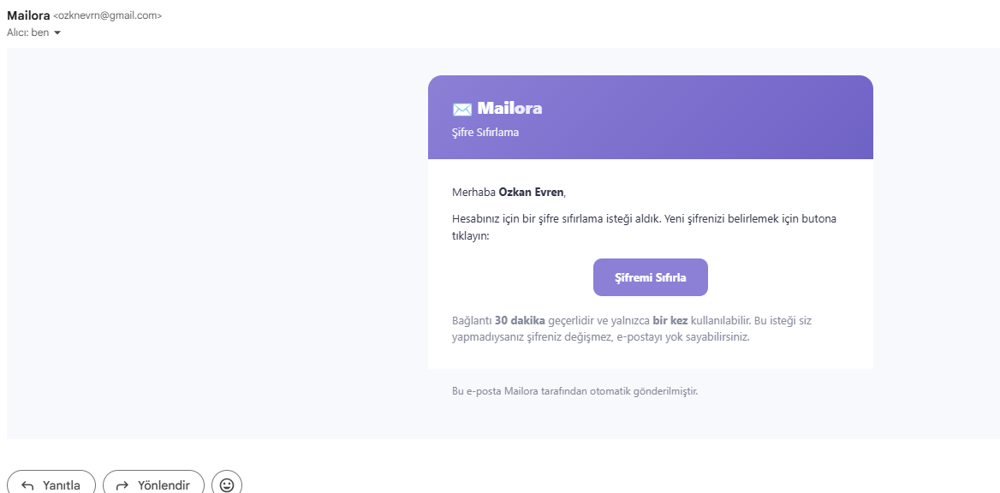 |

### Dashboard
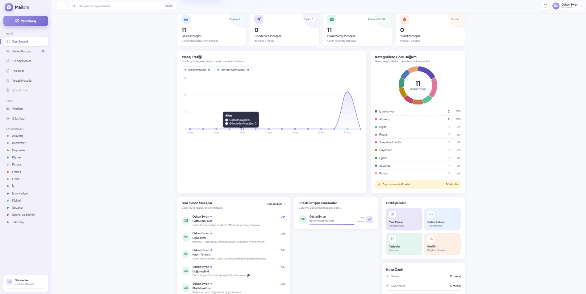

### Gelen Kutusu ve bildirimler
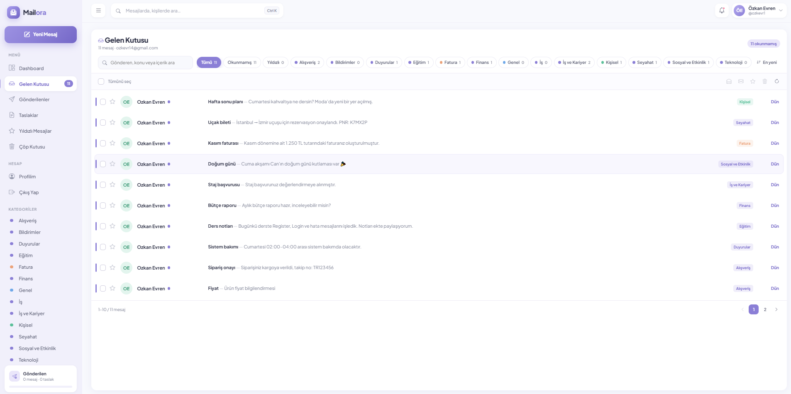

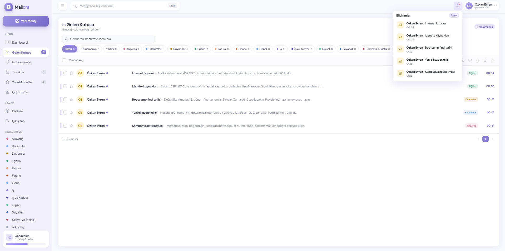

### Gönderilenler ve mesaj detayı
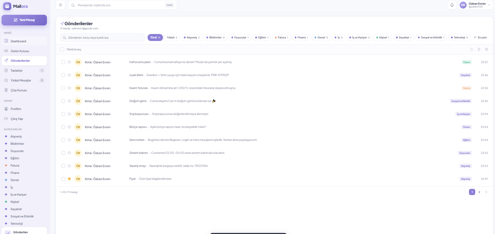

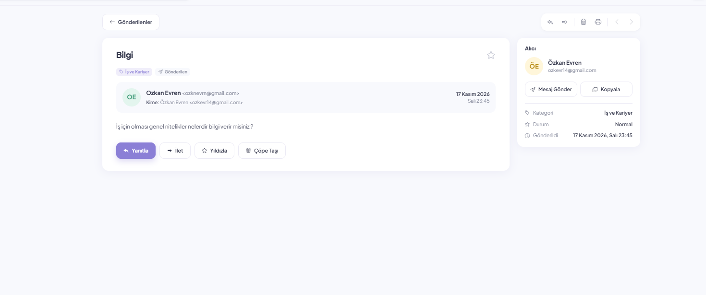

### Yeni mesaj
| Kategoriler veritabanından | Alan doğrulama |
|---|---|
| 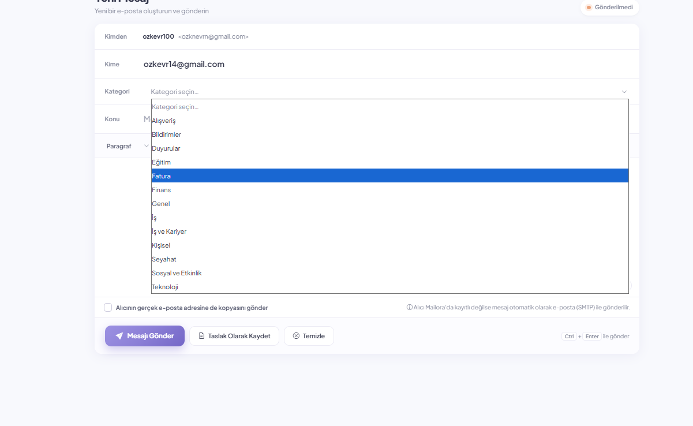 | 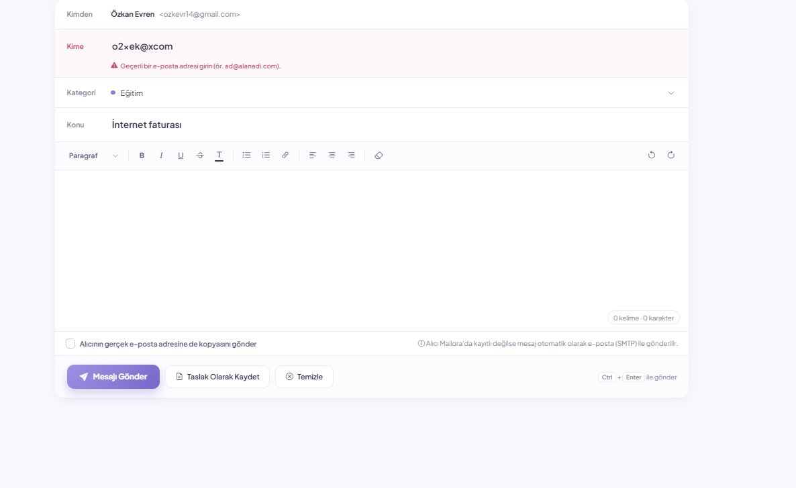 |

### SMTP ile gerçek e-posta gönderimi
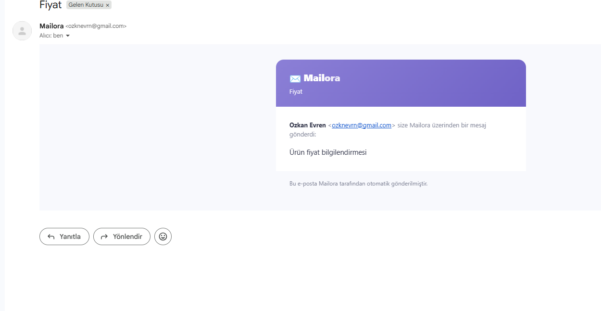

---

## 👤 Geliştirici

**Özkan Evren** · M&Y Yazılım Eğitim Akademi 12. Dönem Bootcamp

### 📝 Geliştirici Notu

Bu projeyi, derslerde birlikte yazdığımız Register, Login, 6 haneli e-posta doğrulama ve e-posta gönderimi altyapısının üzerine kurdum. Verilen Mailora temasını Layout ve ViewComponent'lere parçalayarak statik sayfaları veritabanından beslenen dinamik ekranlara dönüştürdüm.

Geliştirme sürecinde en çok güvenlik tarafına dikkat ettim: kullanıcıların URL'deki id'yi değiştirerek başkasının mesajını görememesi, şifre sıfırlama bağlantısının tek kullanımlık ve süreli olması, gönderen bilgisinin formdan değil Identity hesabından alınması gibi. Bir mesajın hem göndereni hem alıcısı olduğu için yıldız ve çöp kutusu bilgilerini iki taraf için ayrı tuttum; böylece alıcının sildiği mesaj gönderenin "Gönderilenler" sayfasından kaybolmuyor.

Geliştirme sürecinde yapay zekâ destekli bir kodlama asistanından yardım aldım. Kayıt, doğrulama, şifre sıfırlama, iki hesap arasında mesajlaşma ve SMTP ile gerçek e-posta gönderimi gibi akışları kendi bilgisayarımda test ettim; ekran görüntüleri bu testlerden alınmıştır.
